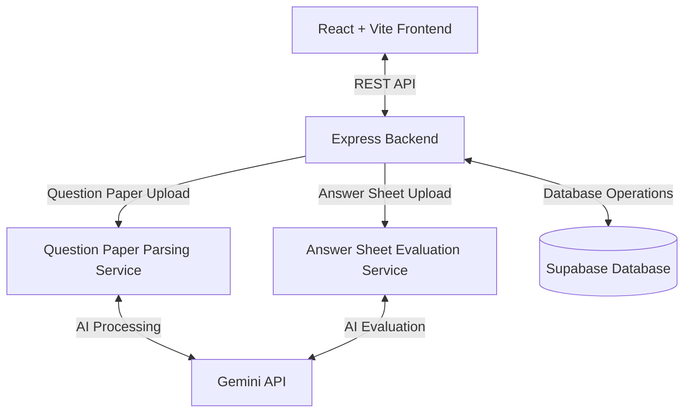

# Exam AI – AI-Powered Automatic Answer Sheet Evaluation System

**Exam AI** is an AI-powered examination assessment platform designed to simplify and accelerate the process of evaluating handwritten student answer sheets.

The system uses generative AI to analyze question papers, process handwritten responses, and evaluate student answers against question-wise marking criteria. It provides structured evaluation results, marks, and AI-generated feedback through an interactive dashboard.

This project is a customized and adapted version of the open-source **Parakh** project by Team Parakh. The application branding, documentation, and selected configurations have been adapted for the Exam AI project.

---

## 1. Project Overview

Traditional answer sheet evaluation requires considerable time and manual effort. Exam AI aims to streamline this process through automated document processing and AI-assisted grading.

### Key Features

- **Question Paper Analysis:** Upload PDF question papers and extract structured questions and marks.
- **AI-Based Processing:** Uses Gemini API for document understanding and structured information extraction.
- **Handwritten Answer Evaluation:** Processes uploaded student answer sheets.
- **Automated Grading:** Evaluates student responses using question-wise marking criteria.
- **Detailed Feedback:** Generates explanations and evaluation notes for individual questions.
- **Student Records:** Stores evaluation details and student information.
- **Interactive Dashboard:** Displays student results, roll numbers, marks, and grading details.
- **Authentication:** Provides teacher registration and login functionality.

---

## 2. System Architecture

Exam AI follows a microservices-based architecture consisting of a React frontend, Express backend, two AI processing services, and a Supabase database.



### Architecture Components

| Component | Technology | Responsibility |
|---|---|---|
| Frontend | React 19, Vite | User interface and dashboard |
| Backend | Node.js, Express | API management and orchestration |
| QP Parsing | Node.js | Question paper extraction |
| AS Parsing | Python, FastAPI | Answer sheet evaluation |
| AI Engine | Google Gemini API | Document understanding and grading |
| Database | Supabase | User, paper, and evaluation records |

---

## 3. Project Directory Structure

```text
sem7_project/
│
├── frontend/
│   ├── src/
│   │   ├── components/
│   │   ├── pages/
│   │   ├── services/
│   │   ├── context/
│   │   └── App.jsx
│   ├── package.json
│   └── vite.config.js
│
├── backend/
│   ├── config/
│   ├── controllers/
│   ├── middleware/
│   ├── routes/
│   ├── services/
│   ├── app.js
│   └── package.json
│
├── ai-service/
│   ├── QP-parsing/
│   │   ├── controllers/
│   │   ├── middlewares/
│   │   ├── prompts/
│   │   ├── schemas/
│   │   └── src/
│   │
│   └── AS-parsing/
│       ├── helpers/
│       ├── pydantic_models/
│       ├── app.py
│       └── requirements.txt
│
├── doc/
│   ├── Architectural docs/
│   ├── example JSONs/
│   ├── schema.sql
│   ├── local_development.md
│   ├── rate_limiting.md
│   └── Timeline.md
│
└── README.md
```

---

## 4. Technology Stack

**Frontend**
- React 19
- Vite
- JavaScript
- CSS

**Backend**
- Node.js
- Express.js
- JWT Authentication

**Artificial Intelligence**
- Google Gemini API
- Python
- FastAPI
- Google GenAI SDK

**Database**
- Supabase
- PostgreSQL

---

## 5. System Requirements

The following software is required:

- Node.js v18 or later
- npm v9 or later
- Python v3.10 or later
- Git
- Google Gemini API key
- Supabase account
- Visual Studio Code (recommended)

---

## 6. Installation and Setup

### Step 1: Database Configuration

1. Create a project in the Supabase dashboard.
2. Open the SQL Editor.
3. Execute the SQL script located at `doc/schema.sql`.
4. Configure the required database permissions and security policies.
5. Obtain the Supabase project URL and server-side service-role key.

The database contains the following main tables:

| Table | Purpose |
|---|---|
| `users` | Stores registered user information |
| `exam_papers` | Stores uploaded question paper data |
| `evaluations` | Stores student evaluation records |

### Step 2: Configure Environment Variables

Create the required `.env` files in the backend, AI services, and frontend directories.

**Backend – `backend/.env`**

```env
PORT=5000
FRONTEND_URL=http://localhost:5173
SUPABASE_URL=your_supabase_project_url
SUPABASE_SERVICE_ROLE_KEY=your_service_role_key
AI_SERVICE_URL=http://localhost:3000
AI_EVALUATION_SERVICE_URL=http://localhost:8000
BACKEND_SERVICE_URL=http://localhost:5000
JWT_SECRET=your_secure_random_secret
ALLOW_REGISTRATION=true
RATE_LIMIT_AI_WINDOW_MS=900000
RATE_LIMIT_AI_MAX=20
RATE_LIMIT_AUTH_WINDOW_MS=900000
RATE_LIMIT_AUTH_MAX=15
QP_PARSING_SECRET=your_qp_service_secret
AS_PARSING_SECRET=your_as_service_secret
```

**Question Paper Parsing – `ai-service/QP-parsing/.env`**

```env
PORT=3000
GEMINI_API_KEY=your_gemini_api_key
QP_PARSING_SECRET=your_qp_service_secret
PRIMARY_MODEL_NAME=your_primary_model
FALLBACK_MODEL_NAME=your_fallback_model
```

**Answer Sheet Evaluation – `ai-service/AS-parsing/.env`**

```env
PORT=8000
GEMINI_API_KEY=your_gemini_api_key
AS_PARSING_SECRET=your_as_service_secret
MODEL_NAME=your_supported_gemini_model
```

**Frontend – `frontend/.env`**

```env
VITE_BACKEND_URL=http://localhost:5000
```

Keep all API keys and database credentials private. Never upload `.env` files to a public repository.

---

## 7. Running the Application

All four services must run concurrently in separate terminals.

### Terminal 1 – Question Paper Parsing

```powershell
cd ai-service/QP-parsing
npm start
```

Service URL: `http://localhost:3000`

### Terminal 2 – Answer Sheet Evaluation

```powershell
cd ai-service/AS-parsing
.\.venv\Scripts\Activate.ps1
python -m uvicorn app:app --host 0.0.0.0 --port 8000
```

Service URL: `http://localhost:8000`

### Terminal 3 – Backend

```powershell
cd backend
npm start
```

Service URL: `http://localhost:5000`

### Terminal 4 – Frontend

```powershell
cd frontend
npm run dev
```

Application URL: `http://localhost:5173`

For complete installation instructions, see `doc/local_development.md`.

---

## 8. Application Workflow

The application follows this sequence:

1. **User Authentication:** Teacher registers or signs in.
2. **Question Paper Upload:** Teacher uploads a question paper PDF.
3. **Question Extraction:** The AI service extracts questions, subquestions, and marks.
4. **Question Review:** Teacher reviews the extracted information and marking criteria.
5. **Save Question Paper:** The processed question paper is stored in Supabase.
6. **Answer Sheet Upload:** Teacher uploads the student's handwritten answer sheet.
7. **AI Evaluation:** The answer sheet is processed and evaluated against the question paper.
8. **Result Generation:** The system generates marks and question-wise evaluation feedback.
9. **Dashboard:** Evaluation results are stored and displayed on the dashboard.

---

## 9. Backend API Overview

The Express backend provides the following main operations.

| Method | Endpoint | Description |
|---|---|---|
| POST | `/api/auth/register` | Register a user |
| POST | `/api/auth/login` | Authenticate a user |
| POST | `/api/exams/upload-paper` | Upload and parse a question paper |
| POST | `/api/exams/generate-rubric` | Save question and rubric data |
| POST | `/api/evaluations/upload-answers` | Upload and evaluate an answer sheet |

The exact request formats and additional endpoints are defined in the backend route files.

---

## 10. Security and Reliability

Exam AI incorporates several security and reliability mechanisms:

- JWT-based user authentication.
- Environment-based secret management.
- Supabase database access controls.
- Separate authentication and AI-processing rate limits.
- Input and file validation.
- Structured AI output validation.
- Error handling across backend and AI services.

---

## 11. Testing and Evaluation

The system can be tested using sample question papers and handwritten answer sheets.

Suggested verification steps:

1. Register a teacher account.
2. Upload a question paper.
3. Verify extracted questions and marks.
4. Save the question paper.
5. Upload a handwritten answer sheet.
6. Verify that evaluation completes successfully.
7. Review question-wise marks and feedback.
8. Verify the student record in the dashboard.

AI-generated marks should be reviewed by a teacher before being used as official academic results.

---

## 12. Limitations and Future Enhancements

Potential future improvements include:

- Improved handwriting recognition for different writing styles.
- Support for additional document languages.
- More detailed rubric-based partial marking.
- Bulk answer sheet processing.
- Exportable evaluation reports.
- Teacher review and correction of AI-generated marks.
- Performance optimization for large PDF documents.
- Additional AI model fallback mechanisms.

---


## 14. Project Information

**Project Name:** Exam AI

**Project Category:** Artificial Intelligence / Educational Technology

**Project Domain:** Automated Examination Assessment

**Primary Objective:** To streamline handwritten answer sheet evaluation through AI-assisted document processing and grading.

**Exam AI – Smarter Assessment Through Artificial Intelligence.**
