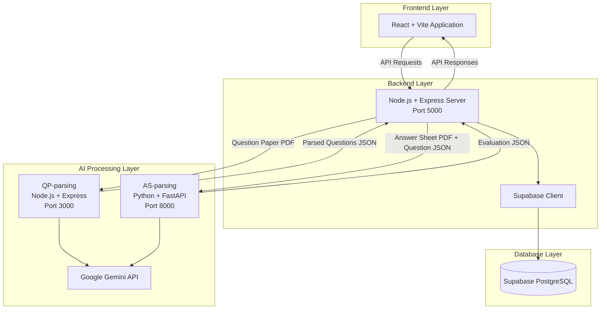
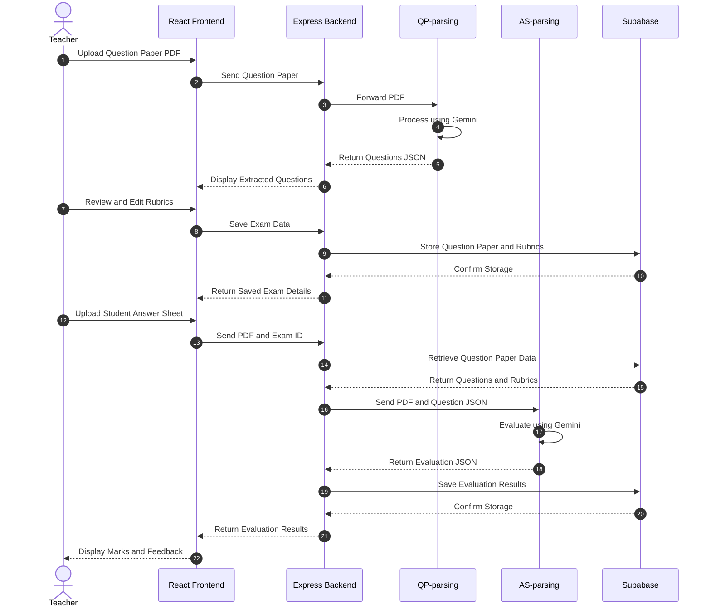
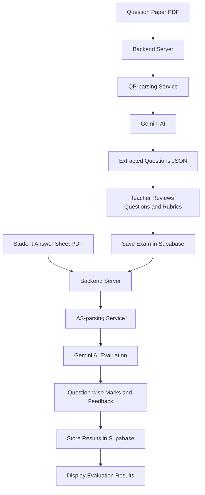

# Exam AI – System Architecture

## 1. Project Overview

**Exam AI** is an AI-assisted web application designed to automate the evaluation of handwritten subjective answer sheets.

The system uses Google's Gemini AI models to process question papers and student answer sheets. It extracts questions and evaluation criteria from question papers, analyses handwritten student responses, and evaluates answers using teacher-defined rubrics.

The application aims to reduce manual evaluation effort, improve consistency, and provide question-wise marks with evaluation explanations.

Teachers remain responsible for reviewing the evaluation criteria and checking the generated results.

---

## 2. High-Level System Architecture

Exam AI follows a **microservices-based architecture** consisting of four main application layers:

1. **Frontend:** React application that provides the interface for teachers.
2. **Backend:** Node.js and Express server that manages requests, file uploads, database operations, and communication with AI services.
3. **AI Processing Services:** Two independent services that process question papers and evaluate student answer sheets.
4. **Database:** Supabase PostgreSQL database that stores user information, question paper data, and evaluation results.

### Architecture Diagram



### Architectural Separation

The backend is the central point of communication between the frontend, database, and AI services.

The two AI services do not directly communicate with Supabase. They receive the required documents and data from the backend, process them using Gemini, and return structured results.

This separation makes the application easier to maintain and allows each service to be developed and tested independently.

---

## 3. Technology Stack

| Layer | Technologies | Responsibilities |
|---|---|---|
| Frontend | React, Vite, JavaScript, CSS | User interface, dashboard, document uploads, rubric review, and evaluation results |
| Backend | Node.js, Express.js, Axios, Multer | API handling, file uploads, service communication, and database operations |
| Question Paper Parsing | Node.js, Express.js, Google GenAI SDK | Extracting questions, marks, and evaluation criteria |
| Answer Sheet Evaluation | Python, FastAPI, Google GenAI SDK, Pydantic | Processing handwritten answers and generating evaluation results |
| Database | Supabase, PostgreSQL | Storing users, question papers, and evaluation records |
| AI Model | Google Gemini API | Document understanding, question extraction, and answer evaluation |

---

## 4. Application Workflow

The application follows two main workflows: question paper processing and student answer sheet evaluation.

### 4.1 Question Paper Processing

1. The teacher logs into the Exam AI application.
2. The teacher uploads a question paper in PDF format.
3. The frontend sends the PDF to the backend.
4. The backend forwards the document to the QP-parsing service.
5. The QP-parsing service processes the document using Gemini.
6. Questions, marks, and available evaluation criteria are extracted into structured JSON.
7. The extracted information is returned to the frontend.
8. The teacher reviews and edits the questions and rubrics before saving the exam.

### 4.2 Answer Sheet Evaluation

1. The teacher selects a previously saved question paper.
2. The teacher uploads a student's answer sheet in PDF format.
3. The frontend sends the PDF and selected exam information to the backend.
4. The backend retrieves the corresponding question paper data from Supabase.
5. The backend forwards the answer sheet PDF and question data to the AS-parsing service.
6. The AS-parsing service uses Gemini to analyse handwritten responses and evaluate them against the available rubrics.
7. The service returns structured evaluation results to the backend.
8. The backend stores the evaluation record in Supabase.
9. The frontend displays the student's marks and evaluation details.

### User Flow Diagram



---

## 5. Repository Structure

The project is organized into separate folders for the frontend, backend, AI services, and documentation.

```text
sem7_project/
│
├── frontend/
│   ├── src/
│   │   ├── components/
│   │   ├── context/
│   │   ├── pages/
│   │   ├── services/
│   │   ├── App.jsx
│   │   └── index.css
│   └── package.json
│
├── backend/
│   ├── config/
│   ├── controllers/
│   ├── middleware/
│   ├── routes/
│   ├── services/
│   ├── app.js
│   └── package.json
│
├── ai-service/
│   ├── QP-parsing/
│   │   ├── controllers/
│   │   ├── middlewares/
│   │   ├── schemas/
│   │   ├── src/
│   │   └── package.json
│   │
│   └── AS-parsing/
│       ├── helpers/
│       ├── pydantic_models/
│       ├── app.py
│       └── requirements.txt
│
├── doc/
│   ├── Architectural docs/
│   ├── example JSONs/
│   ├── schema.sql
│   ├── api_endpoints.md
│   ├── local_development.md
│   └── systemarchitecture.md
│
├── testing assets/
└── README.md
```

*Note: This is a simplified representation of the main project folders. Some files and subfolders have been omitted for readability.*

---

## 6. Service Module Responsibilities

### 6.1 Frontend – React

The frontend provides the user interface through which teachers interact with the application.

Its responsibilities include:

- User registration and login.
- Displaying the teacher dashboard.
- Uploading question papers and student answer sheets.
- Displaying extracted questions and rubrics.
- Allowing teachers to review and edit evaluation criteria.
- Displaying evaluation results and marks.

### 6.2 Backend – Node.js and Express

The backend acts as the central orchestration layer.

Its responsibilities include:

- Handling frontend API requests.
- Managing uploaded files.
- Communicating with the QP-parsing and AS-parsing services.
- Connecting to Supabase.
- Saving and retrieving question paper and evaluation records.
- Returning evaluation results to the frontend.

### 6.3 Question Paper Parsing – QP-parsing

This service is responsible for extracting structured information from question papers.

Its main responsibilities include:

- Receiving uploaded question paper PDFs.
- Processing documents using the Google Gemini API.
- Extracting exam information, questions, marks, and available rubrics.
- Returning structured JSON data to the backend.
- Validating and cleaning up temporary files.

### 6.4 Answer Sheet Evaluation – AS-parsing

This service is responsible for analysing and evaluating student answer sheets.

Its main responsibilities include:

- Receiving answer sheet PDFs and question paper JSON.
- Processing handwritten responses using Gemini.
- Analysing answers against the provided evaluation criteria.
- Generating question-wise marks and evaluation explanations.
- Returning structured evaluation results.
- Validating the generated output using Pydantic models.

---

## 7. AI Processing Pipeline

The AI pipeline consists of three major stages.

### Stage 1: Question Paper Extraction

The uploaded question paper is sent to the QP-parsing service. Gemini analyses the document and extracts questions, marks, and available rubric information into structured JSON.

### Stage 2: Rubric Storage

The extracted question data is presented to the teacher for review. After the teacher saves the exam, the backend stores the question paper information and evaluation criteria in the `exam_papers` table.

### Stage 3: Answer Sheet Evaluation

The backend retrieves the saved question data and sends it along with the student's answer sheet to the AS-parsing service. Gemini analyses the responses and generates structured evaluation results, which are then stored in the `evaluations` table.

### AI Pipeline Diagram



---

## 8. Database Design

Exam AI uses **Supabase PostgreSQL** as its database.

The backend communicates with Supabase through the Supabase client library.

The main application tables are:

### 8.1 Users

Stores registered user information required for application authentication and account management.

### 8.2 exam_papers

Stores uploaded question paper information and extracted question data.

Important fields include:

- `id`: Unique identifier for the question paper.
- `pdf_filename`: Name of the uploaded question paper.
- `parsed_data`: JSONB data containing extracted questions, marks, and rubrics.
- `created_at`: Record creation date and time.

### 8.3 evaluations

Stores the evaluation results generated for student answer sheets.

Important fields include:

- `id`: Unique evaluation identifier.
- `exam_paper_id`: Reference to the associated question paper.
- `pdf_filename`: Uploaded answer sheet filename.
- `parsed_data`: JSONB data containing detailed evaluation results.
- `student_name`: Student's name.
- `roll_number`: Student's roll number.
- `exam_code`: Examination identifier.
- `subject`: Subject name.
- `obtained_marks`: Marks obtained by the student.
- `max_marks`: Maximum possible marks.
- `created_at`: Evaluation date and time.

The database schema and table definitions are maintained in `doc/schema.sql`.

---

## 9. Security and Data Handling

The application uses separate environment configuration files for service credentials and application settings.

Important security measures include:

- API keys and database credentials are stored in environment variables.
- The Supabase service-role key is used only by the backend.
- The frontend communicates with the backend instead of accessing the database directly.
- Authentication and protected API routes help restrict access to application resources.
- File validation is performed before processing uploaded documents.
- AI services use configured service authentication to control backend requests.

**Important:** Secret keys and environment files should not be included in screenshots, public repositories, or project documentation.

---

## 10. Future Enhancements

The following features can be considered for future development:

1. **Teacher Mark Adjustment:** Allow teachers to modify AI-generated marks.
2. **Confidence Indicators:** Display confidence levels for individual question evaluations.
3. **Multilingual Evaluation:** Support answers written in different languages.
4. **Plagiarism Detection:** Compare student responses to identify potential copying.
5. **Performance Analytics:** Provide class-level performance reports and question-wise analysis.
6. **Handwriting Feedback:** Provide feedback on handwriting readability.

These are proposed enhancements and are not represented as currently implemented features.

---

## 11. Conclusion

Exam AI combines web technologies, database management, and multimodal AI processing to support the evaluation of handwritten subjective answer sheets.

Its modular architecture separates the user interface, backend operations, question paper extraction, and answer sheet evaluation. This makes the system easier to understand, maintain, and extend.

The application is intended to assist teachers in the evaluation process. AI-generated marks should be reviewed by a teacher before being treated as final academic results.

---
